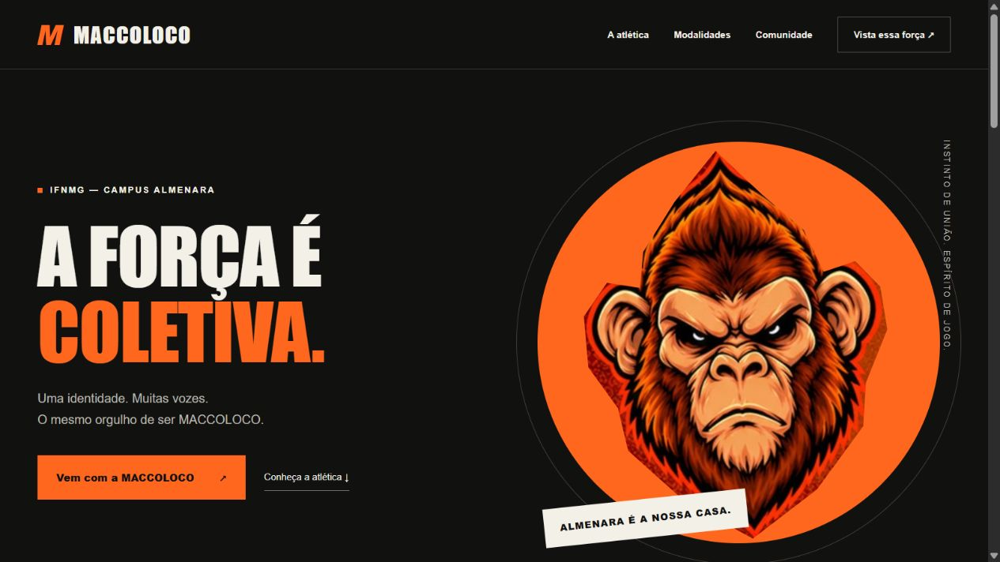
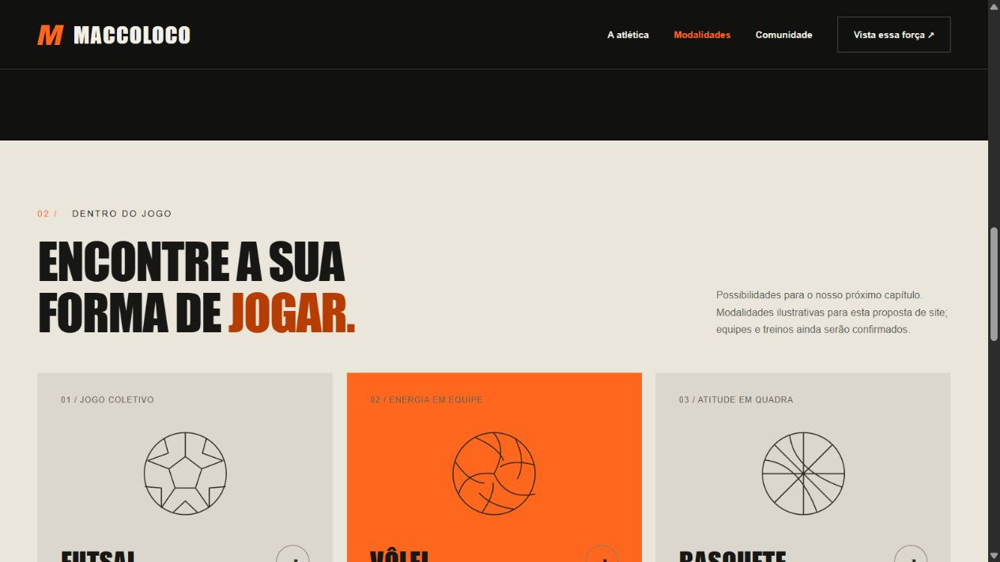

# Atlética Maccoloco

Landing page de apresentação da Atlética Maccoloco, do IFNMG — campus Almenara. Projeto desenvolvido com **HTML, CSS e JavaScript**, com identidade visual, navegação por seções, menu mobile e diálogos informativos.

## Processo

Parti da identidade e do mascote da atlética. Organizei a apresentação em seções para introduzir a proposta, explorar modalidades e apresentar a comunidade. Depois desenvolvi o visual responsivo e os diálogos, mantendo claro que as modalidades ainda são propostas.

## Executar

Abra `index.html` no navegador ou, com Python instalado, execute na raiz:

```sh
python -m http.server 8000
```

Acesse http://localhost:8000. Não há instalação de dependências ou etapa de build. Os estilos, scripts e a imagem de identidade estão incorporados ao HTML.

## Imagens





## Estágio e limites

- Proposta de website, sem backend ou envio de inscrições.
- As modalidades são ilustrativas e dependem de confirmação da atlética.
- Navegação, menu em largura de celular e diálogos foram conferidos na entrega original; a validação em celular físico segue pendente.
- A identidade e o mascote pertencem aos seus respectivos titulares. Sua presença neste projeto não concede autorização para reutilização das marcas.

## Autor

[Marcos Ryan Oliveira Porto](https://github.com/marcosryan10) · [LinkedIn](https://www.linkedin.com/in/marcosryanl/)
